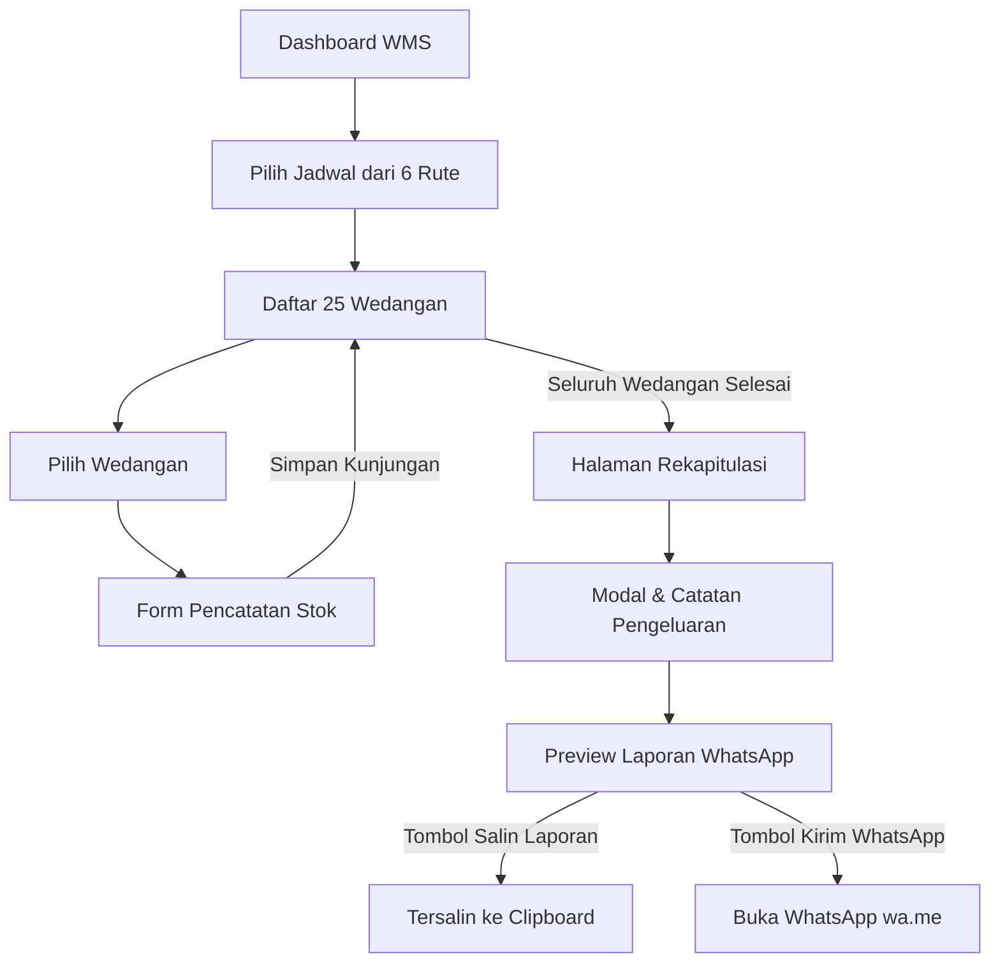

# PRODUCT REQUIREMENT DOCUMENT (PRD)
## WEDANGAN MANAGEMENT SYSTEM (WMS)

**Versi Dokumen:** 1.0.0  
**Tanggal Rilis:** 25 November 2026  
**Status:** Approved & Implemented (Tahap 1 & 2 Selesai)  
**Penyusun:** Senior Product Manager & Senior Frontend Engineer  

---

## 1. Ringkasan Eksekutif & Visi Produk

### 1.1 Latar Belakang
Wedangan Management System (WMS) adalah aplikasi web berbasis *Mobile First* dan *Offline First* (PWA) yang dirancang khusus untuk memfasilitasi pencatatan distribusi produk makanan harian ke sekitar 25 wedangan/HIK (Hidangan Istimewa Klaten/Solo) per jadwal kunjungan.

### 1.2 Masalah yang Diselesaikan
- Menghilangkan pencatatan manual berbasis kertas saat berkendara mengantarkan barang antar-wedangan.
- Mencegah kesalahan kalkulasi stok sisa, produk terjual (laku), stok baru, dan total setoran.
- Mempercepat penyusunan dan pengiriman laporan harian ke WhatsApp pemilik/pengelola tanpa perlu mengetik ulang rekapan manual.
- Menyediakan aplikasi mandiri yang bekerja instan tanpa ketergantungan koneksi internet (offline-ready) dan tanpa biaya operasional server/database eksternal.

---

## 2. Prinsip Arsitektur & Batasan Teknis (Constraints)

| Parameter | Ketentuan Teknis |
| :--- | :--- |
| **Framework** | Next.js App Router (React 19, TypeScript) |
| **Styling** | Tailwind CSS v4 (Custom brand palette: Orange `#FF9012`, Cyan `#3EB8EB`) |
| **Backend & DB** | **Tanpa backend eksternal** (Tanpa Laravel, MySQL, Supabase, Firebase, atau REST API). Seluruh kalkulasi dan state berjalan di browser klien. |
| **Penyimpanan Data** | LocalStorage dengan skema versi (`wms_v1_`) dan mekanisme reactive store (`useSyncExternalStore`) yang bebas dari *hydration mismatch*. Dilengkapi fitur **Auto-Purge Tengah Malam (00:00)** untuk menghapus data kunjungan & pengeluaran sementara setiap pergantian hari. |
| **Penyebaran / Deployment**| PWA (Progressive Web App) dengan manifest.json, dapat diinstall langsung di Android/iOS (*Add to Home Screen*). |
| **Integrasi Eksternal**| WhatsApp Click-to-Chat (`https://wa.me/?text=...`) & Clipboard API. |

---

## 3. Alur Pengguna (User Flow)



---

## 4. Rincian Kebutuhan Fungsional (Functional Requirements)

### 4.1 Modul 1: Dashboard & Jadwal Distribusi
1. **Header Oranye**: Menampilkan logo WMS, judul sistem, dan ikon navigasi ke pengaturan.
2. **Kartu Hari Ini**: Menampilkan hari dan tanggal operasional dengan tautan langsung ke rute hari tersebut.
3. **Statistik Utama**:
   - Total wedangan pada rute terpilih.
   - Total produk terjual (laku) akumulatif.
   - Total nilai penjualan kotor (Gross Sales).
4. **Tombol CTA**: *"Lihat Rute Hari Ini →"* untuk akses cepat satu klik.
5. **Jadwal Tersedia (6 Rute)**:
   - Senin Pagi (Pasar Legi - Manahan - Kota Baru)
   - Senin Malam (Kustati - Gandekan - Beteng)
   - Selasa Pagi (Jebres - UNS - Palur)
   - Selasa Malam (Solo Baru - Tanjung Anom - Grogol)
   - Rabu Pagi (Kartasura - Pajang - Makohan)
   - Rabu Malam (Nusukan - Kadipiro - Mojosongo)

### 4.2 Modul 2: Form Pencatatan Wedangan
Setiap wedangan memiliki field pencatatan dengan formula bisnis yang terkunci:

$$\text{Qty Terjual} = \text{Stock Awal} - \text{Stock Sisa}$$
$$\text{Stock Akhir} = \text{Stock Sisa} + \text{Stock Baru}$$

**Aturan Bisnis & Validasi:**
- **Riwayat Stok Otomatis**: `Stock Awal` mengambil nilai `Stock Akhir` dari kunjungan sebelumnya pada wedangan tersebut jika tersedia; jika belum ada mengambil nilai default (20 pcs).
- **Snapshot Harga**: Menyimpan harga unit saat kunjungan dicatat (default Rp1.500) agar perubahan harga di kemudian hari tidak mengubah transaksi historis.
- **Validasi Angka**: Tidak boleh bernilai negatif ($< 0$).
- **Validasi Sisa**: `Stock Sisa` tidak boleh melebihi `Stock Awal`. Jika dilanggar, form memunculkan pesan error dan menonaktifkan tombol simpan.
- **Kemudahan Input Mobile**: Dilengkapi tombol stepper cepat (`+` dan `-`) untuk operasional satu tangan di smartphone.

### 4.3 Modul 3: Status & Indikator Kunjungan
- Di halaman daftar wedangan, setiap baris menampilkan:
  - Nomor urut dan nama wedangan.
  - Status kunjungan: **Sudah dicatat** (ikon centang hijau) atau **Belum dicatat** (lingkaran abu-abu).
  - Ringkasan laku dan sisa untuk wedangan yang sudah selesai dicatat.
- **Progress Bar**: Menampilkan persentase dan rasio progres visual (contoh: *15 dari 25 wedangan selesai*).

### 4.4 Modul 4: Rekapitulasi Rute
- Dapat diakses saat seluruh wedangan selesai (atau ditinjau secara berkala).
- Menampilkan metrik terperinci:
  - Total Stock Awal (pcs)
  - Total Stock Sisa (pcs)
  - Total Laku (pcs)
  - Total Kirim Baru (pcs)
  - Total Stock Akhir (pcs)
  - Total Nilai Penjualan ($=\text{Total Laku} \times \text{Harga Produk}$)
- Format mata uang menggunakan standar Rupiah Indonesia `Intl.NumberFormat('id-ID')`.
- **Proteksi Laporan**: Memberikan peringatan tegas jika masih ada wedangan yang belum dicatat sebelum lanjut ke tahap pengeluaran.

### 4.5 Modul 5: Manajemen Pengeluaran Operasional
- Menampung pencatatan pengeluaran selama perjalanan distribusi (bensin, makan, parkir, plastik, dll.).
- Pengguna dapat menambah banyak pos pengeluaran dan menghapus baris yang salah.
- Disediakan chip pilih cepat: `🍽️ Makan`, `⛽ Bensin`, `🅿️ Parkir`, `🛍️ Plastik`.
- Menghitung **Total Setor**:
  $$\text{Total Setor} = \text{Total Penjualan} - \text{Total Pengeluaran}$$

### 4.6 Modul 6: Format Pesan WhatsApp & Clipboard
Format pesan WhatsApp terstandarisasi secara dinamis:

```text
LAPORAN DISTRIBUSI
[NAMA_HARI_DAN_WAKTU]
Tanggal: [TANGGAL_LENGKAP]

RUTE:
[AREA_DISTRIBUSI]

1. [NAMA_WEDANGAN]
   Stock Awal: [X]
   Laku: [Y]
   Stock Sisa: [Z]
   Kirim Baru: [A]
   Stock Akhir: [B]

... (seluruh 25 wedangan)

TOTAL:
Total Laku: [TOTAL_LAKU] pcs
Harga: [HARGA_UNIT]
Total Penjualan: [TOTAL_PENJUALAN]

PENGELUARAN:
1. [NAMA_PENGELUARAN]: [NOMINAL]
Total Pengeluaran: [TOTAL_PENGELUARAN]

TOTAL SETOR:
[PENJUALAN] - [PENGELUARAN] = [TOTAL_SETOR]
```

- Konten di-encode menggunakan `encodeURIComponent`.
- URL trigger WhatsApp: `https://wa.me/?text=[ISI_PESAN]`.
- Tersedia tombol **Salin Laporan** dengan notifikasi toast.
- Tersedia tombol **Lihat Format Pesan WhatsApp** untuk preview sebelum dikirim.

### 4.7 Modul 7: Pengaturan, Backup, Reset & Auto-Purge Tengah Malam
- **Auto-Purge Jam 12 Malam (00:00)**:
  - Setiap pergantian hari (pukul 00:00 atau saat aplikasi dibuka di tanggal baru), data sementara berupa catatan kunjungan (`visits`) dan pengeluaran (`expenses`) otomatis dibersihkan agar aplikasi siap untuk rute shift berikutnya.
  - Sebelum dibersihkan, stok akhir (`stockAkhir`) dari masing-masing wedangan otomatis diarsipkan ke cache riwayat (`PREVIOUS_STOCKS`), sehingga `Stock Awal` pada kunjungan hari berikutnya tetap dapat terisi otomatis.
  - Pengaturan permanen (harga produk, nama rute, kustomisasi nama wedangan) tidak akan terhapus.
- **Pengaturan Harga Unit**: Mengubah tarif dasar produk (disimpan di LocalStorage).
- **Kustomisasi Nama Wedangan**: Mengubah nama wedangan per jadwal tanpa perlu mengubah kode sumber.
- **Backup & Pemulihan (JSON)**:
  - *Export JSON*: Mengunduh snapshot database lokal ke file `.json`.
  - *Import JSON*: Membaca file backup dan memulihkan data lokal.
- **Reset Data**: Menghapus seluruh data transaksi lokal dengan dialog konfirmasi keamanan 2 tahap.

---

## 5. Struktur Data & Skema TypeScript

```typescript
// Wedangan / Stall Entity
export interface Stall {
  id: string;
  name: string;
  sequence: number;
  area?: string;
  initialStockDefault?: number;
}

// Route Schedule Entity (6 Jadwal)
export interface RouteDay {
  id: string;
  name: string;
  shortName: string;
  timeOfDay: 'pagi' | 'malam';
  dayName: 'Senin' | 'Selasa' | 'Rabu' | 'Kamis' | 'Jumat' | 'Sabtu' | 'Minggu';
  routeArea: string;
  stalls: Stall[];
}

// Visit Transaction Record
export interface VisitRecord {
  stallId: string;
  dayId: string;
  stockAwal: number;
  stockSisa: number;
  qtyTerjual: number;
  stockBaru: number;
  stockAkhir: number;
  unitPrice: number;     // Snapshot harga saat transaksi dicatat
  isCompleted: boolean;
  updatedAt: string;
}

// Operational Expense Item
export interface ExpenseItem {
  id: string;
  title: string;
  amount: number;
  category?: 'makan' | 'bensin' | 'parkir' | 'lainnya';
}

// App Settings
export interface AppSettings {
  defaultPrice: number;
  appName: string;
  activeDayId: string;
}
```

---

## 6. Desain Sistem & Panduan UI/UX

| Unsur Desain | Spesifikasi |
| :--- | :--- |
| **Warna Primer** | Oranye (`#FF9012`), Hover (`#E67E08`), Light (`#FFF4E5`) |
| **Warna Sekunder** | Cyan (`#3EB8EB`), Light (`#EBF8FE`) |
| **Status Hijau (Sukses)** | Emerald (`#10B981` / `#059669`), Light (`#ECFDF5`) |
| **Status Merah (Bahaya)**| Rose (`#E11D48`), Light (`#FFF1F2`) |
| **Latar Belakang** | Abu-abu Sangat Muda (`#F8F9FA`), Kartu Putih Bersih (`#FFFFFF`) |
| **Tipografi** | System UI San-Serif (Inter/Roboto/Segoe UI) |
| **Dimensi Layar** | Mobile First, lebar maksimal `max-w-md` (448px) terpusat dengan bayangan tepi halus |
| **Ergonomi Navigasi** | *Bottom Navigation Bar* 4 tab yang selalu dapat dijangkau jempol tangan kanan |

---

## 7. Panduan Pembaruan Fitur Mendatang (Future Roadmap & Extension Guide)

Bagi pengembang yang akan melanjutkan atau memperbarui fitur di masa depan, harap mematuhi ketentuan berikut:

1. **Menambah Rute Baru**:
   - Tambahkan objek rute baru di file [src/data/dummy-routes.ts](file:///d:/Development/Project/Wedangan-management/src/data/dummy-routes.ts).
   - Pastikan ID rute unik dan tambahkan di fungsi `generateStaticParams()` pada halaman dinamis.
2. **Menambah Jenis Produk (Multi-Product)**:
   - Jika di masa depan produk yang didistribusikan lebih dari 1 macam (misal: Nasi Kucing + Sate + Gorengan), ubah field `qtyTerjual`, `stockAwal`, dll. pada `VisitRecord` menjadi array produk `products: { productId, stockAwal, stockSisa, ... }[]`.
   - Pastikan fungsi [src/lib/calculations.ts](file:///d:/Development/Project/Wedangan-management/src/lib/calculations.ts) di-*overload* untuk mendukung perhitungan per produk.
3. **Penyimpanan Cloud Opsional**:
   - Jika sewaktu-waktu pemilik membutuhkan sinkronisasi antar-perangkat, buat adapter penyimpanan baru di samping [src/lib/storage.ts](file:///d:/Development/Project/Wedangan-management/src/lib/storage.ts) tanpa mengubah struktur state pada komponen UI.
4. **Cetak Struk Thermal (Bluetooth)**:
   - Dapat diintegrasikan menggunakan Web Bluetooth API dengan memanfaatkan data yang sudah dihitung pada `RouteSummary` dan `VisitRecord`.

---

*Dokumen ini merupakan referensi resmi pengembangan Wedangan Management System (WMS).*
